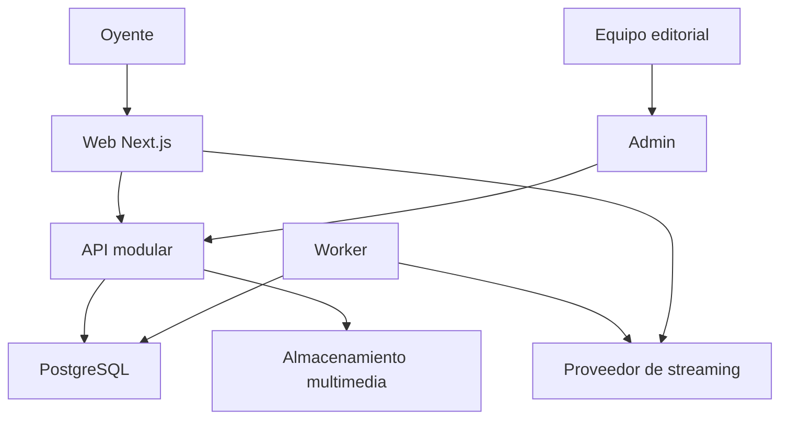

# Arquitectura propuesta

## Decisión principal

Monorepo con web y administración separadas, una API modular y un worker. No microservicios. Se conserva la estructura solicitada, añadiendo worker, contratos y módulos de servidor porque monitoreo, transcodificación y publicación programada no deben depender de una visita web ni de temporizadores en una función efímera.

La separación aumenta despliegues y configuración, pero permite que el panel evolucione sin cargar sus dependencias al oyente. API y worker comparten lógica y base de datos; son procesos con responsabilidades distintas, no servicios de negocio independientes.



El audio viaja del proveedor al navegador. La API no retransmite el stream; evita costo de egress duplicado y conexiones interminables. El worker consulta salud y metadata autorizadas, sin exponer credenciales al navegador.

## Alternativas consideradas

| Alternativa | Ventaja | Limitación | Decisión |
|---|---|---|---|
| Next único con admin y Route Handlers | Menos despliegues | Acoplamiento y jobs externos igualmente necesarios | Válido si presupuesto obliga a reducir operación |
| Next + admin + API modular | Límites claros y reutilización futura | Más configuración y contratos | Propuesta base acorde al encargo |
| NestJS | Convenciones y DI útiles para equipo grande | Mayor estructura inicial | Reevaluar si el equipo ya lo utiliza |
| Fastify modular | API explícita y validación por schemas | Hay que disciplinar dominios y políticas | Candidato preferido; versión/plugins pendientes de lockfile |
| Microservicios | Escalado independiente por dominio | Complejidad operativa injustificada | Excluidos |
| SPA Vite pública | Sencillez de cliente | SEO editorial requiere renderizado adicional | Admin puede usar React/Vite; web pública Next |

## Frontend

Web con App Router, Server Components para contenido editorial y pequeñas islas cliente para filtros, player y motion. Root layout público contiene PlayerProvider y AudioEngine una sola vez; páginas no poseen audio. `Link` para navegación interna; no usar claves por pathname/municipio en el provider ni un template que lo remonte. Separar estado editorial, estado del reproductor y preferencias visuales. Context con reducer tipado y comandos estables es suficiente; suscriptores de progreso no rerenderizan toda la página.

API pública solo devuelve DTOs publicados. Caché por estación, municipio, tipo y versión; invalidación después de commit editorial mediante outbox/reintento. Programación actual usa respuesta corta con serverTime y próxima transición; no una home cacheada indefinidamente. Errores de noticias no desmontan el player. Admin usa consultas no cacheadas públicamente; autenticación no se decide en componentes visuales.

Rutas públicas: `/`, `/municipios/[slug]`, `/noticias/[slug]`, `/programacion`, `/locutores/[slug]`, `/podcasts`, `/podcasts/[slug]/[episode]`, `/eventos/[slug]`, `/emisoras`. Búsqueda editorial por texto y filtros con paginación; full-text PostgreSQL antes de añadir motor externo.

Admin separado bajo `/admin` mediante proxy del mismo origen, con base path/base URL configurados y assets resueltos allí. Navegar de la web al admin cruza aplicaciones y puede detener audio; la continuidad garantizada por diseño cubre rutas públicas. Admin no requiere audio persistente. Si hosting no admite proxy por rutas, usar subdominio administrativo con cookies exclusivas y revisar CSRF/CORS, sin cookies compartidas a todo el dominio.

## Backend

Dominios: identity, stations, geography, editorial, programming, podcasts, events, community, campaigns, media, monitoring y audit. Capas: rutas/DTO → política → servicio de dominio → repositorio. Ningún controlador acepta stationId como prueba de autorización. Transacciones en publicación, concesión de permisos y cambios de agenda.

API REST versionada `/api/v1`. OpenAPI y contratos compartidos; DTOs públicos separados de modelos Prisma. Endpoints representativos: GET municipalities, articles, schedules?date=&stationId=, stations/:id/now, stations/:id/playback; POST admin/articles; POST admin/articles/:id/submit; POST admin/articles/:id/publish; PUT admin/schedules/:id; GET admin/streams/health; POST submissions; POST polls/:id/votes. Mutaciones usan versión/If-Match para evitar perder ediciones; conflicto devuelve 409. Paginación por cursor con tope y filtros admitidos explícitos.

El worker utiliza jobs persistidos en PostgreSQL con lease, bloqueo y reintentos acotados. Publicación y auditoría son transaccionales; el envío a CDN se procesa con outbox idempotente. Varios workers no ejecutan el mismo trabajo simultáneamente. Redis se añade solo si carga o arquitectura lo justifican; rate limit distribuido debe resolverse desde la primera réplica adicional.

## Árbol propuesto — no creado como aplicación

```text
la-jefa-platform/
  apps/
    web/src/app/
    web/src/features/
    admin/src/
    api/src/modules/
    worker/src/jobs/
  packages/
    ui/src/
    player/src/
    contracts/src/
    server-domain/src/
    config/
    types/
  database/
    prisma/
    migrations/
    seeds/
  assets/required-assets.md
  docs/
  tests/unit/
  tests/integration/
  tests/e2e/
  tests/fixtures/
  scripts/
  .env.example
  package.json
  pnpm-workspace.yaml
  pnpm-lock.yaml
  README.md
```

Los archivos de configuración anteriores son nombres propuestos, no archivos ya operativos. Un solo gestor y lockfile. `server-domain` y `database` nunca entran en bundles cliente. No crear paquetes vacíos sin consumidores.

## Infraestructura y operación

Runtime Node con procesos persistentes para API/worker, PostgreSQL administrado, almacenamiento de objetos y CDN de imágenes/media, proveedor de streaming existente. Dominio, plataforma y región pendientes. Separar desarrollo, staging y producción con bases y buckets distintos. Iniciar con una réplica API y worker con límites; escalar con métricas. Pool total = conexiones por proceso × réplicas + jobs + migraciones, con margen reservado.

Cookies y APIs privadas sin caché CDN; contenido editorial público con TTL e invalidación. Streaming no pasa por service worker ni por caché offline. Backups cifrados, restauración ensayada y despliegues reversibles. Objetivos RPO/RTO pendientes del negocio, no inventados.
